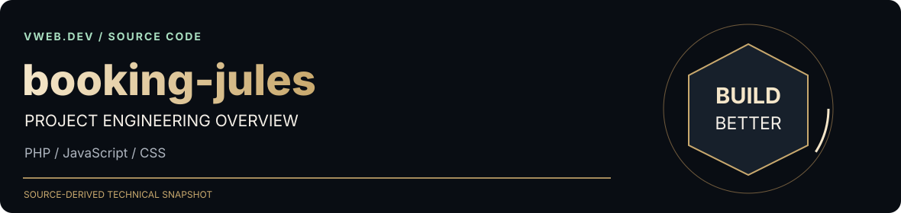

<!-- VWEB:AUTO-README:START -->

### Code-derived project snapshot

| Attribute | Detected value |
|---|---|
| Latest source revision | `498cdc17fad3` |
| Tracked files reviewed | 52 |
| Framework and platform indicators | PHP  /  JavaScript  /  CSS |
| Source file types | PHP (32), JavaScript (3), CSS (1) |
| Main directories | public_html |

> This section is regenerated from tracked filenames and manifests on code updates. It is not a QA or production-readiness certification. Handwritten project documentation is preserved.
<!-- VWEB:AUTO-README:END -->

# booking-jules
